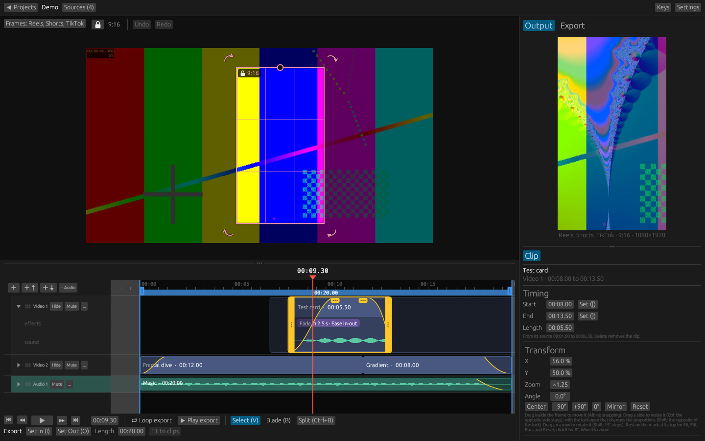
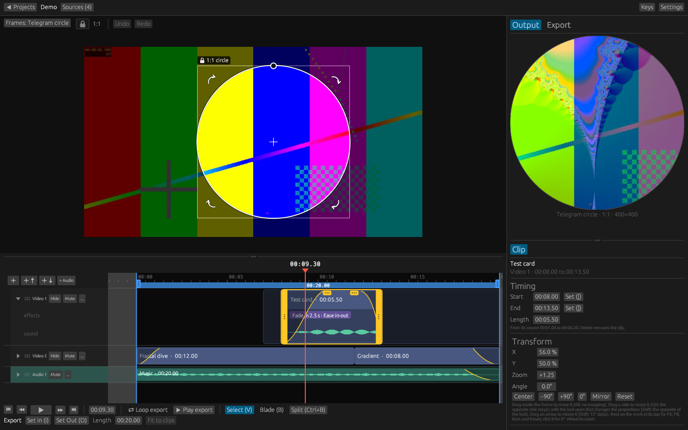
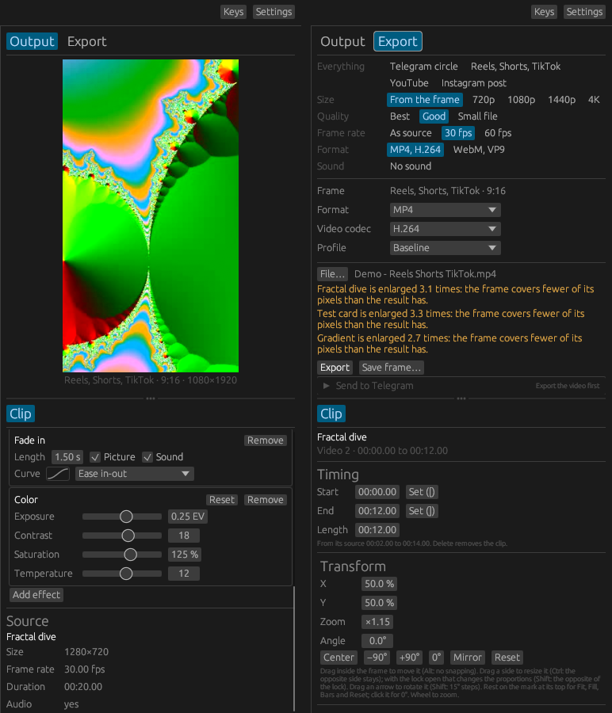
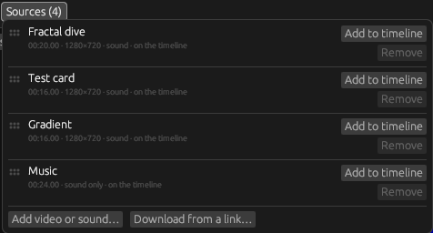
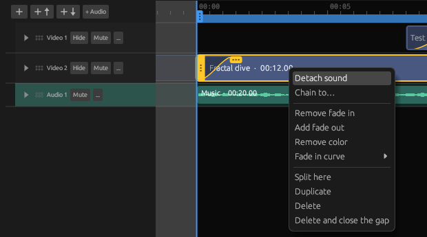
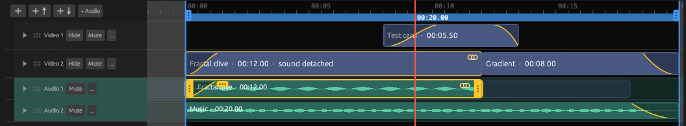
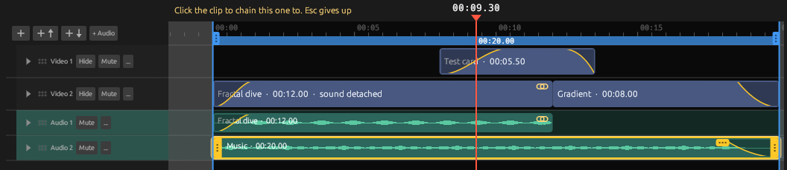

# DicingSplicing

A simple video editor for short videos: Telegram circles, Reels, Shorts, TikTok and the like.
Cut a few clips together, frame them for the platform, add fades and a bit of color, and export.
A finished circle can go straight to a Telegram channel.



## Download

Get the latest version from [Releases](https://github.com/Ma11doror/DicingSplicing/releases).
Unpack the zip anywhere and run `dicing_splicing.exe`: nothing has to be installed. FFmpeg and
yt-dlp come along in the same folder.

- Windows 10 or 11, 64-bit.
- The program is not signed, so on the first start Windows may say it protected your PC.
  Choose **More info**, then **Run anyway**.
- On the first start the editor asks for a folder for your projects. The frames it prepares for
  playback are kept there too, so it needs some free space.

## What it does

**Clips and tracks**

- Several videos in one project, on as many tracks as you need. The top visible track is what is
  seen; the sound of all of them is mixed.
- Videos are linked, not copied. Add them from a file, by dropping them on the window, or by a link
  (YouTube, song.link and whatever else [yt-dlp](https://github.com/yt-dlp/yt-dlp) understands).
- Move clips along and between tracks, trim them by their edges, cut them with the Blade or at the
  playhead, duplicate, copy and paste, delete with or without closing the gap. Undo and redo
  everything.
- Unfold a track to see each clip's effects and the graph of its sound.

**Sound**

- Audio tracks between the video tracks, in any order: lower than video tracks and of another
  shade, so that sound stays next to its picture.
- Detach the sound of a clip: it becomes a clip of its own on an audio track under it, to move,
  cut, trim and fade on its own. The two stay chained: moved in time, they go together.
- Chain any clips to each other, or unchain them, from the clip's menu: cut a piece out of the
  sound or the picture, delete it, and chain what is left to other clips.
- Music and other sound files (MP3, WAV, M4A, FLAC, OGG, Opus) as sources, on audio tracks.

Step by step, with pictures: [Working with sound](#working-with-sound).

**Framing for the platform**



- Frames for Telegram circle (1:1), Reels, Shorts and TikTok (9:16), landscape (16:9), tablet
  (16:10), photo (3:2), classic (4:3), square, Instagram post (4:5), cinema (21:9), or your own ratio.
- Move, resize and rotate the frame right on the picture, with snapping; mirror the picture; fill
  the frame or leave black bars. Thirds, center and safe-area guides.
- Show the frames of other platforms inside the main one, to make a cut that fits them all.

**Effects on each clip**



- Fade in and fade out, of the picture, the sound or both: linear, ease in, ease out, ease in-out,
  and stronger versions of the eases. A clip fading out reveals the clip under it, or black.
- Color: exposure, contrast, saturation and temperature.
- What the Output panel shows is what the file gets: the same formulas run in the preview and
  in the export.

**Export**

- Presets for Telegram circles, Reels, Shorts and TikTok, YouTube and Instagram posts, or every
  setting by hand: size, quality, frame rate, MP4 (H.264), WebM (VP9), MOV or MKV, AAC or Opus.
- Sound fades at the edges of the file, and even loudness (-14 LUFS, as most sites play).
- Save a single frame as a picture.
- Send to Telegram: a finished circle goes to your channel, with a caption and a link
  (see [Sending to Telegram](#sending-to-telegram)).

## Quick start

1. On the start screen, **New project from a video…**, or drop a video on the window.
2. Open **Frames** at the top left and pick the main frame, such as *Telegram circle*. Move and
   resize the frame on the picture.
3. More videos or music: **Sources**, then **Add video or sound…** or **Download from a link…**. Drag a
   source onto the timeline; onto an audio track it goes as its sound only.

   

4. Pick a clip to change it in the **Clip** panel on the right: timing, framing, volume, effects.
   Right click a clip for its menu: detach its sound, chain it to another clip, fades, color, cut,
   duplicate, delete.
5. Set the part to export with **I** and **O**, or **Fit to clips**.
6. **Export** tab: choose a preset, then **Export**.

Press **F1** in the editor for the list of keys.

## Working with sound

1. **Detach the sound of a clip.** Right click a video clip and choose **Detach sound**.

   

2. **The sound is now a clip of its own,** on an audio track right under its picture: move it, cut
   it, trim it and fade it on its own. The picture says *sound detached*. The two are **chained**:
   both carry a mark of two chain links, and when one is moved in time, the other goes along.
   Select one, and the clips chained to it are outlined.

   

3. **Chain any clips.** Right click a clip, choose **Chain to…**, then click the clip to chain it to;
   Esc gives up. Here the music is about to be chained to the test card, to follow the card when it
   is moved.

   

4. **Unchain**, in the same menu, lets a clip move on its own again; the others stay chained. Both
   parts of a cut stay chained: cut a piece out of the sound, delete it, and chain what is left to
   other clips.
5. **Music and other sound files** come in through **Sources**, **Add video or sound…**: MP3, WAV,
   M4A, FLAC, OGG or Opus. Drag one onto an audio track; dropped anywhere else, it gets a new audio
   track. A video dragged onto an audio track brings only its sound.

## Keys

| Keys | What they do |
|---|---|
| Space | Play or pause |
| K / L | Pause / play |
| Left / Right | One frame back / forward |
| Shift+Left / Shift+Right | One second back / forward |
| Up / Down | To the start / end of the export range |
| Home / End | To the start / end of the clips |
| I / O | Start / end the export range at the playhead |
| [ / ] | Trim the selected clip's start / end to the playhead |
| Ctrl+B | Cut the selected clip at the playhead |
| Ctrl+D | Duplicate the selected clip, right after it |
| Ctrl+C / Ctrl+V | Copy the selected clip / paste it at the playhead |
| Delete | Delete the selected clip |
| Shift+Delete | Delete it and close the gap on its track |
| Ctrl+Z | Undo |
| Ctrl+Y, Ctrl+Shift+Z | Redo |
| V or Esc | Select tool: pick, move and trim clips |
| B | Blade tool: a click cuts a clip, with Shift every clip there |
| F1 | The list of keys and mouse actions |

**Mouse**

| Where | What it does |
|---|---|
| Click on the ruler | Takes the playhead there |
| Drag a clip | Moves it, also onto another track of its kind; chained clips go along |
| Drag an edge of the selected clip | Trims it |
| Drag the dots on the top edge of the selected clip | Changes the length of its fade |
| Right click on a clip | Its menu |
| Double click on a clip | Unfolds or folds its track |
| Drag with the right or middle button | Moves along the time, and the tracks up and down |
| Wheel | Zooms; over the track names, scrolls the tracks |
| Drag the dots of a track | Moves the track up or down |
| Drag the dots above the timeline, or above Clip | Resizes the panels |
| Drag in Output | Moves the selected clip's picture; the wheel zooms it |

## Sending to Telegram

The *Send to Telegram* plugin posts a finished circle to a channel through your own bot. It needs a
file named `credentials.json` next to `dicing_splicing-telegram.exe`, or chosen in **Settings**:

```json
{
  "bot_token": "123456789:your-bot-token",
  "chat_id": "@your_channel",
  "chat_id_test": "@your_test_channel"
}
```

Create the bot with [@BotFather](https://t.me/BotFather) and make it an admin of the channels.
The test channel comes first in the list, so a send to the main channel is always a deliberate
choice. Keep the file to yourself: the token gives full control of the bot. It is listed in
`.gitignore`, and the build script refuses to package it.

## Where things are

- Projects, prepared frames and downloaded videos: the projects folder you chose (Settings).
- Settings: `%APPDATA%\DicingSplicing\settings.json`.
- Error reports: `%APPDATA%\DicingSplicing\logs`. If the editor closes on an error, it says so on the
  next start; please attach the report to an issue.

## Building from source

You need [Rust](https://rustup.rs) (stable; on Windows the MSVC toolchain), and FFmpeg with ffprobe
on the PATH, or their paths set in Settings. yt-dlp is needed only for downloading by link.

```
git clone https://github.com/Ma11doror/DicingSplicing.git
cd DicingSplicing
cargo run
```

- `cargo build` builds the editor and both plugins into `target\debug`. Plugins are found next to
  the editor, so after changing one, use `cargo build`: `cargo run` rebuilds only the editor.
- `cargo test --workspace` runs the tests. Some of them run FFmpeg, and are skipped without it.
- `scripts\package.cmd` builds a release and gathers everything it needs to run into
  `dist\DicingSplicing-<version>\`, with a zip next to it: the editor, its plugins, FFmpeg, yt-dlp
  and the licenses.

It is developed and tested on Windows 11. The libraries it uses run on Linux and macOS too, but the
editor has not been tried there, and the build script is for Windows only.

## Plugins

A plugin is a separate program named `dicing_splicing-<id>`, next to the editor or in
`%APPDATA%\DicingSplicing\plugins`, and can be written in any language. The editor runs it with
`--describe` to learn what it is, and talks to it with command-line arguments and one JSON object
per line. A *source* plugin brings in a video; a *publish* plugin does something with a finished
file. The protocol is described in [src/core/plugins.rs](src/core/plugins.rs); the two plugins in
[plugins/](plugins) are working examples.

## Contributing

**Pull requests are highly welcome!** Bug fixes, new effects, export presets, plugins, support for
other systems, translations of the docs: all of it.

- For a larger change, open an issue first to talk it over.
- Run `cargo test --workspace` and `cargo clippy --workspace --all-targets` before sending.
- Bug reports help most with the steps that lead to the problem and, if the editor closed, the
  report from `%APPDATA%\DicingSplicing\logs`.

## License

DicingSplicing is licensed under the [Apache License 2.0](LICENSE). You are free to use, change and
share it, also as part of your own work. If you distribute it or anything based on it, keep the
[NOTICE](NOTICE) file, which names this program and links back here, and mark the files you
changed, as the license asks.

Release archives also contain programs of other projects, each under its own license:
[FFmpeg](https://ffmpeg.org) (`ffmpeg.exe`, `ffprobe.exe`; this build is under the GNU GPL v3, see
`ffmpeg-LICENSE.txt` and `ffmpeg-README.txt` in the archive) and
[yt-dlp](https://github.com/yt-dlp/yt-dlp). The licenses of the Rust libraries built into the
programs are collected in `THIRD-PARTY-LICENSES.txt` in each release.

## Credits

Built with [egui and eframe](https://github.com/emilk/egui), [cpal](https://github.com/RustAudio/cpal),
[image](https://github.com/image-rs/image) and [rfd](https://github.com/PolyMeilex/rfd). Video is read
and written by [FFmpeg](https://ffmpeg.org); videos by link come through
[yt-dlp](https://github.com/yt-dlp/yt-dlp).

The pictures and the music in the screenshots are made by FFmpeg itself: a test card, a Mandelbrot
fractal, gradients and two tones.
